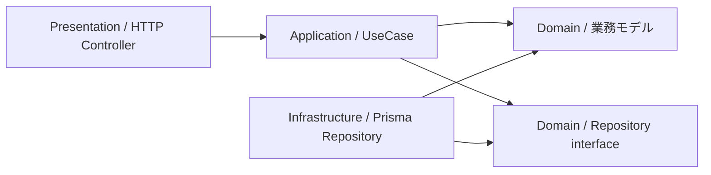

# バックエンド構成

## フロントエンド構成

Next.js App Router を使い、画面固有のコードと複数画面で使う UI を分ける。

```text
src/
├── app/                         # route、page、layout
│   └── projects/
│       └── page.tsx
├── components/
│   ├── ui/                      # shadcn/ui を土台にした汎用 UI
│   └── common/                  # StatusBadge など複数画面で使う部品
├── features/                    # projects、tasks など業務機能ごとの UI・API 呼び出し
└── lib/                         # API client、認証、共通関数
```

- `components/ui` は shadcn/ui の部品を配置・調整する場所にする。
- `components/common` には、アプリ固有だが複数画面で使う小さな UI を置く。
- `features` には、画面をまたいで共有する業務機能ごとの定義・UI・処理を置く。現在は `tasks/types` と `projects/types` に、状態・優先度・権限の定義を配置する。
- `features/*/types` には、関連する型・値の候補を表す定数・表示名をまとめる。`task-status.ts`・`task-priority.ts` は `features/tasks/types`、`project-role.ts` は `features/projects/types` に置く。これらは `app` 配下のコードに依存させない。
- 画面専用の小さな部品は、その route 配下の `_components` に置いてよい。
- カスタム Hook は、コンポーネント専用なら `use`＋コンポーネント名、複数箇所で使う共通 Hook なら処理内容が分かる名前にする。ファイル名は `use-project-member-role-editor.ts` のように kebab-case にする。
- UI 部品は必要に応じて Storybook の story を追加し、画面を開かなくても状態を確認できるようにする。

Project 関連の現在の配置は、利用する画面の範囲に合わせる。以下は `src/app/(app)/projects` 配下を基準とする。

| 利用範囲 | 配置 |
| --- | --- |
| 一覧画面のテーブル・テスト | `(list)/_components` |
| 新規作成の API 呼び出し・テスト | `new/_lib` |
| タスク・メンバー・設定で共有する Project 詳細取得・テスト | `[projectId]/_lib` |
| メンバーの取得・追加・権限変更・削除の API 呼び出しと Hook・テスト | `[projectId]/members/_lib` |
| 共通ナビゲーションと一覧で使う Project 一覧取得、共有するエラー型 | `projects` 直下の `_lib` |

タスクの状態・優先度と Project の role は、上記の route 配下から `src/features/tasks/types`・`src/features/projects/types` を直接 import して使う。

ログアウト操作のテストは `(app)/_components/logout-button.test.tsx` に置く。

### Web の認証基盤

Supabase Auth のセッションは `@supabase/ssr` を使って Cookie に保存する。
`src/lib/supabase/client.ts` はブラウザ用、`server.ts` はリクエストごとの Cookie を参照するサーバー用クライアントを作る。
共有する接続設定は公開用の URL と Publishable key に限り、`apps/web/.env.local` に設定する。

Next.js の `src/proxy.ts` は認証・Project の画面表示前に `src/lib/supabase/proxy.ts` を呼ぶ。
Server Component は Cookie を書けないため、Proxy で SDK の `getClaims()` による確認・更新を行い、
更新した Cookie を後続の画面処理とブラウザの両方へ渡す。SDK が返すキャッシュ制御ヘッダーも維持する。
未ログインの `/projects` とその配下へのリクエストは `/login` にリダイレクトする。
ログイン画面をリダイレクト対象にせず、更新 Cookie とキャッシュ制御ヘッダーをどちらの応答にも付ける。

ログイン画面は `(auth)/login` に置き、Server Component のページと Client Component のフォームに分ける。
ログイン後は `/api/auth/me` の本人取得を待ってプロジェクト一覧へ移動する。
Project の一覧・詳細はサーバー用クライアント、それ以外の作成・更新・アーカイブ・解除はブラウザ用クライアントでセッションを取得し、全 6 API に Bearer token を付ける。
登録画面は `(auth)/register` に置き、ページと操作するフォームを分ける。
フォームは `signUp()` に名前・メールアドレス・パスワードを渡し、メール確認待ちの案内を表示する。
確認用パスワードは入力検証だけに使い、名前は `user_metadata.name` に保存する。
API の共通 AuthGuard が `getUser(token)` で本人を確認した後、AuthService が名前を正規化して AuthRepository に渡す。
アプリ側 User の作成・更新時にメールと名前を同期し、名前が未設定・空白・文字列以外なら `null` にする。
`user_metadata` は表示用の名前にだけ使い、認可判断には使わない。

メール確認後の初回表示では、複数の API が同じ User を並行して保存する。
AuthRepository の upsert が一意制約エラー（P2002）になった場合は、同じ ID・メールの行が既にあることを確認し、その行を1回だけ更新する。
別 ID とのメール競合やその他の DB エラーは引き継ぎ、メールだけを根拠に別の User を本人として扱わない。

メール確認の Route Handler は `(auth)/confirm/route.ts` に置く。Route Group の名前は URL に含まれないため、URL は `/confirm` となる。
サーバー用クライアントの `verifyOtp()` で `token_hash` と `type=email` を検証し、発行されたセッションを Cookie に保存する。
成功時は `/projects`、検証エラー時は `/login?error=confirmation_failed` にリダイレクトする。
確認情報がない場合や `type` が不正な場合は、Supabase を呼ばず `400` の JSON を返す。
リダイレクト先には元の確認情報を引き継がず、応答には `Cache-Control: private, no-store` と `Referrer-Policy: no-referrer` を付ける。
確認後は Project API の AuthGuard で本人を確認し、アプリ側 User を取得または初回作成する。

`(app)/layout.tsx` の Server Component `ProjectsNavigationContainer` が Cookie のセッションから token を取得し、
共通の `src/lib/auth/get-current-user.ts` で本人情報を取得する。ナビゲーション用の Project 一覧と本人情報は並行して取得する。
取得した一覧・名前・メールを同じ `navigationProps` で `ProjectsSidebar` と `AppHeader` に渡す。
各コンポーネントから `UserMenu` に名前とメールを渡し、名前が `null` なら「ユーザー」と表示する。
token はサーバーから表示用の Client Component に渡さない。

共通の取得処理を `Suspense` で囲み、取得中は `ProjectsSidebarFallback` と `ProjectsAppHeaderFallback` を描画する。
通常表示と fallback の両方で Tailwind CSS の `lg`（64rem / 通常1024px）を境界に表示を切り替える。
`lg` 以上はサイドバー、`lg` 未満は高さ48pxのヘッダーを表示し、fallback も同じ領域を確保する。

Client Component の `AppHeader` は、左にハンバーガーメニュー、中央にロゴと `Redmine Nest`、右に名前の先頭文字のアイコンを表示する。
右のアイコンには操作を持たせず、ハンバーガーメニューから shadcn/ui の Sheet を開く。
Sheet はプロジェクト一覧・詳細へのリンクを表示し、現在の項目を青色にして `aria-current="page"` を付ける。
リンク選択時は Sheet を閉じ、リストだけをスクロール可能にして `UserMenu` を最下部に置く。

`UserMenu` は表示用 props とメニューの UI を扱い、`LogoutButton` はログアウト処理・処理中の状態・エラー表示を持つ。
`AppHeader` は Sheet とその中のユーザーメニューの開閉を管理し、Sheet を閉じる時や PC 幅への切り替え時に小メニューも閉じる。
`signOut({ scope: 'local' })` で現在のセッションを終了し、SDK が Cookie を更新した後、`/login` へ移動・画面情報を更新する。
`LogoutButton` をメニューの開閉でアンマウントさせず、Sheet も `keepMounted` で状態を保持する。
再び開いた場合もログアウト処理中の状態とエラーを保持する。
NestJS API でも token を検証し、membership・role による認可は既存の実装順に沿って追加する。

### メンバー一覧画面

`projects/[projectId]/members/page.tsx` は Server Component とし、Project 詳細、メンバー一覧、本人情報の順に取得する。
Project 詳細とメンバー一覧は `projects/[projectId]/_lib/get-project.ts`・`projects/[projectId]/members/_lib/get-project-members.ts` が Cookie のセッションから token を取得して API に渡す。
ページは本人情報の取得にも Cookie のセッションを使い、共通の `getCurrentUser(accessToken)` に token を渡す。認証済みの本人情報は API で検証した結果を使う。
Project 詳細または一覧の取得が `null` なら `notFound()` を呼び、空配列は0件の正常な取得結果として扱う。

ヘッダーと URL に対応したナビゲーションは、詳細ページと共通の `[projectId]/_components` に置く。
`members/_components/project-members-list.tsx` は Client Component とし、`projectId`、取得済みのメンバー、本人の User.id、`currentUserRole` と `isArchived` を受け取り、一覧を表示する。`members/_lib/use-project-member-role-editor.ts` の `useProjectMemberRoleEditor` と `use-delete-project-member-dialog.ts` の `useDeleteProjectMemberDialog` を直接1回ずつ呼び、権限編集・削除の状態と操作を受け取る。一覧取得やセッションの確認は持たない。
本人の目印は `member.userId === currentUserId` で判断する。表示用の props に access token を含めない。
設定リンクは詳細の `currentUserRole` が owner の場合だけ表示し、API 側の membership・role 検証も維持する。

メンバー一覧 API は Repository で参加日時・ID の昇順に1回で取得し、その順序を保ったまま owner を先頭にまとめる。member・viewer の違いは並び順に使わず、権限変更だけで行が移動しないようにする。Web は API の配列順で表示する。

一覧の `headerAction` は JSX を受け取る表示枠とし、ページが owner の場合だけ `AddProjectMemberDialog` を渡す。ページから Dialog には `projectId` と `isArchived` を渡す。
`AddProjectMemberDialog` は Client Component とし、開閉・入力検証・送信中の制御・結果の表示を扱う。`projects/[projectId]/members/_lib/add-project-member.ts` がブラウザーのセッションから token を取得して追加 API に渡す。
追加成功後は `router.refresh()` で Server Component の一覧を再取得する。API の認証・認可・アーカイブ状態の検証も維持する。

権限変更は行内編集とし、一覧内で編集対象の ProjectMember.id と選択中の role を管理する。対象と選択を PC・モバイルで共有するため、両方の表示を持つ一覧を Client Component にする。ページは Server Component のままとし、親が渡す `headerAction` の配置も一覧に残す。
一覧全体のヘッダー・空状態・繰り返し表示は `project-members-list.tsx`、1人分の表示は `project-member-item.tsx` に分ける。Item は PC 用の `ProjectMemberTableRow` とモバイル用の `ProjectMemberCard` を公開し、状態と操作の関数を List から props で受け取る。
編集欄は `project-member-role-editor.tsx` の `ProjectMemberRoleEditor` に分け、Item から読み込んで PC の権限セルとモバイルのカード下部で使う。Editor は選択中の role・選択変更と取消の関数・送信ハンドラー・アーカイブ状態・送信中の状態・エラーを props で受け取る。`useProjectMemberRoleEditor` は編集対象の ID と API エラーを `useState`、選択中の role を1つの `useForm` で管理する。List は各 Hook から受け取った値と関数を PC・モバイルの両方へ渡す。Item・Editor・Dialog・各 Hook は Client Component の List 配下で読み込むため、`'use client'` は List だけに置く。
Hook に member・viewer のみを許可する Zod スキーマと、そのスキーマから推論したフォームの型を置く。`useForm` は `zodResolver` と `mode: 'onSubmit'` を設定し、`useController` の `field.value`・`field.onChange` を `editingRole`・`handleRoleChange` として List に返す。List は React Hook Form の API を直接扱わない。選択値の `useState` は持たず、編集開始時は `reset({ role: member.role })`、取消時は `reset()` を使う。owner は編集開始の処理でも対象外にする。
owner だけに操作を表示し、対象が owner の場合は表示しない。アーカイブ済みでは操作を無効にする。
Editor はそれぞれ `form` を持ち、List から受け取った `handleSave` に送信を渡す。Hook は `handleSubmit(onSubmit)` を `handleSave` として返し、入力検証後に保存する。項目エラーは選択欄の下に表示し、PC・モバイルが同時に DOM に存在しても `aria-describedby` が重複しないよう、対象 ID と表示種別から別々のエラー ID を付ける。
Hook の `onSubmit` は `updateProjectMemberRole(projectId, editingMemberId, values)` を呼ぶ。`projects/[projectId]/members/_lib/update-project-member-role.ts` がブラウザーのセッションから token を取得し、既存の PATCH API に渡す。対象は User.id ではなく ProjectMember.id とする。API 側の認証・認可・owner 保護・アーカイブ状態の検証も維持する。
送信中は `isSubmitting` を PC・モバイルで共有し、入力・保存・取消・別の対象への切り替えを無効にする。失敗時は入力と編集対象を保持し、業務エラーはメッセージ、その他の失敗は固定の案内を表示する。404・409 を status だけで項目エラーへ変換しない。成功時は通知・フォーム初期化・編集終了の後、`router.refresh()` で一覧を再取得する。

削除確認の対象 `memberToDelete` と開閉状態 `isDeleteDialogOpen`、送信中の `isDeleting`、API エラーの `deleteError` は `useDeleteProjectMemberDialog` で管理する。Hook の `handleOpenDeleteDialog(member)` は owner だけに許可し、アーカイブ済み・対象が owner・削除中なら開かない。List は権限保存中のチェックを行う `handleOpenDeleteDialog` を Item の `onDelete` に渡す。Item は削除ボタンの `onClick` で呼ぶ。削除中は Item の権限変更・削除の入口と、Editor の選択・保存・取消も無効にする。権限変更の `isSubmitting` と削除の `isDeleting` は分け、削除中に権限の「保存中...」を表示しない。
List は表・カード一覧の外に1つ置いた `DeleteProjectMemberDialog` へ対象の名前・メール、開閉状態、送信中の状態、エラーを渡す。`onClose` は `(open: boolean) => void` の `handleCloseDeleteDialog` を受け取り、AlertDialog の `onOpenChange` にそのまま渡す。Hook は true と削除中の閉じる通知を無視し、送信していないときの false で閉じる。閉じるアニメーション中の名前・メールを保つため対象は次に開くまで保持する。
Dialog は `onDelete` に受け取った List の `handleDeleteMember` を確定ボタンから呼ぶ。List は権限保存中でないこと、削除 Hook は対象・開閉状態・権限・アーカイブ状態・自身が削除中でないことを確認し、`deleteProjectMember(projectId, memberToDelete.id)` を呼ぶ。`projects/[projectId]/members/_lib/delete-project-member.ts` がブラウザーのセッションから token を取得して既存 DELETE API へ渡し、204成功時は `response.json()` を呼ばない。API 側の認証・認可・対象の Project 所属確認・owner 保護・transaction は維持する。
失敗時は対象と Dialog を保持し、業務エラーはメッセージ、その他は権限変更と同じ固定の案内を表示する。404・409 を status だけで分類しない。`finally` で送信中の状態を解除し、再試行・閉じる操作を許可する。成功後の通知・Dialog の閉鎖・`router.refresh()` は API の try/catch から分ける。List の配列は手元で削除せず、Server Component から渡される一覧で更新する。

List は各 Hook の戻り値を `roleEditor`・`deleteDialog` として受け取り、状態と関数の担当を明示する。両 Hook は `projectId`・`currentUserRole`・`isArchived` を受け取り、各操作の状態・API 呼び出し・エラー・通知・一覧更新を担当する。相手の送信状態は持たず、List のハンドラーで削除中の権限編集開始・取消・保存と、権限保存中の削除確認・削除実行を拒否する。権限保存を拒否するときは form の既定動作も止める。未使用になった `useProjectMembersList` と専用テストは削除し、各操作の単体テストと List の操作テストで確認する。

メンバーの参加日とプロジェクト一覧の更新日は、共通の `apps/web/src/lib/format-date.ts` の `formatDate` で表示する。日時の文字列を受け取り、`ja-JP`・`Asia/Tokyo` を使って日本時間の `YYYY/MM/DD` 形式に揃える。

同じ route の `loading.tsx` は Server Component のスケルトンを定義し、Next.js がデータ取得中に表示する。
`error.tsx` は Client Component とし、固定のエラー案内、Next.js から渡される `retry()` による再取得、`/projects` へ戻るリンクを表示する。
Project 詳細・メンバー一覧 API の404は404画面、それ以外の取得失敗は共通のエラー案内で扱う。内部エラーの内容をそのまま画面へ出さない。

## テスト構成

| 対象                      | 主な道具                       | 例                                               |
| ------------------------- | ------------------------------ | ------------------------------------------------ |
| UI コンポーネント         | Vitest + React Testing Library | フォームの入力エラー、ボタン押下、空状態         |
| UI の見た目・状態カタログ | Storybook                      | StatusBadge の各 status、Button の disabled 状態 |
| NestJS API                | Vitest + Supertest             | `POST /projects` の成功、400、403、404           |
| ブラウザ全体の導線        | Playwright                     | ログイン → プロジェクト作成 → タスク作成         |

Storybook は自動テストの代わりではない。UI を目で確認・共有するカタログとして使い、操作や仕様の確認は Vitest / Playwright で行う。

## 採用する構成

現在は NestJS の Module を機能ごとに分け、その機能内でレイヤード構成にする。業務ルールを理解・実装した後、一部の操作に DDD のモデルを導入し、その操作の依存関係をクリーンアーキテクチャに沿って整理する。

現在の処理の流れ:

```text
HTTP request
  -> Controller
  -> Service
  -> Repository
  -> PrismaService
  -> PostgreSQL
```

```text
src/
└── modules/
    ├── health/
    ├── prisma/
    │   ├── prisma.module.ts
    │   └── prisma.service.ts
    ├── auth/
    │   ├── auth.controller.ts
    │   ├── auth.service.ts
    │   ├── auth.repository.ts
    │   └── auth.module.ts
    ├── projects/
    │   ├── dto/
    │   │   ├── create-project.dto.ts
    │   │   ├── update-project.dto.ts
    │   │   └── project-response.dto.ts
    │   ├── projects.controller.ts
    │   ├── projects.service.ts
    │   ├── projects.repository.ts
    │   └── projects.module.ts
    └── tasks/
        ├── dto/
        │   └── task-response.dto.ts
        ├── tasks.controller.ts
        ├── tasks.service.ts
        ├── tasks.repository.ts
        └── tasks.module.ts
```

上記は現在の主な構成である。Task の DB 定義と一覧 API は PR #37 で `develop` にマージ済みで、`feat/phase-2/task-detail-api` では同じ構成に詳細 API を追加した。DDD やクリーンアーキテクチャへの移行は、対象操作を決めてから行う。

`TasksModule` は `PrismaModule` と `AuthModule` を import し、`TaskController`・`TasksService`・`TasksRepository` を登録する。`AppModule` から `TasksModule` を読み込む。
一覧・詳細は AuthGuard による token・メール確認と User 同期の後、Controller が URL の Project ID と本人の User ID を Service に渡す。詳細では URL の Task ID も渡す。
Service は Repository から本人の参加情報を取得し、なければ既存 Project API と同じ404を返す。owner・member・viewer の全 role に閲覧を許可し、アーカイブ状態では拒否しない。詳細の `findOne()` は参加情報の確認後に Task を取得し、対象がなければ「タスクが見つかりません」の404を返す。
Repository の `findAll()` は Task を Project ID で限定し、作成日時・ID の降順で取得する。詳細の `findById()` は Prisma の `findUnique()` に Task ID と Project ID を指定し、両方が一致する1件または `null` を返す。
Controller が返却項目を明示し、日付・日時を API の文字列形式に変換する。一覧は配列、詳細は単一オブジェクトを返し、既存の `TaskResponseDto` を共有する。レスポンス DTO 自体は変換処理を持たない。

## それぞれの責務

| 層            | 役割                                                           | 例                                     |
| ------------- | -------------------------------------------------------------- | -------------------------------------- |
| Controller    | HTTP の受付と応答を担当する。入力 DTO を受け、Service を呼ぶ。 | `POST /projects` を受ける              |
| Service       | 機能の処理の流れと業務ルールを担当する。                       | プロジェクト名を確認して保存を依頼する |
| Repository    | DB 操作をまとめる。Prisma の query をここに置く。              | `findById()`、`create()`               |
| PrismaService | Prisma Client を NestJS から使うための共通窓口。               | `prisma.project.findMany()`            |
| DTO           | API で受け取る入力の形とバリデーションを定義する。             | `name` は必須文字列                    |

## Repository を採用する理由

Repository は「Service が DB の細かな書き方を知らずに、データを取得・保存するための窓口」である。

```ts
// Service: 何をしたいかを書く
return this.projectsRepository.findById(id);

// Repository: Prisma を使って、どう取得するかを書く
return this.prisma.project.findUnique({ where: { id } });
```

Repository を通じて Service とデータアクセスの責務を分離する。現在の段階では、`projects.repository.ts` の1ファイルで実装する。

クリーンアーキテクチャへ移行する操作では、内側に Repository interface を定義し、外側に Prisma を使う実装を置く。UseCase が必要な保存・取得の操作を interface として表し、具体的な DB 実装から独立させることを学ぶ。

## 守るルール

- Controller に Prisma の query や複雑な業務判断を書かない。
- Service に HTTP の `Request` / `Response` を渡さない。
- Repository は HTTP の知識を持たない。
- DTO は API 入力用であり、DB の型をそのまま公開するものではない。
- 現段階では、複数の機能にまたがる処理もまず Service で読みやすく書く。関連する業務ルールを理解した後、対象操作のドメインモデルや UseCase へ整理する。
- UseCase や Repository interface は、依存関係を整理する段階に進んだ操作に導入する。導入する層の役割と、移動する処理を説明する。
- 認証済みユーザー・Project membership・role は API 側で確認する。構成を移しても、同じ認証・認可ルールを適用する。

## DDD・クリーンアーキテクチャの導入方針

2026-10-03 に、学習しながら「ルールを理解する → モデルにする → 依存を整理する」と進める方針を決めた。DDD は業務の用語・ルールをモデルへ表現する考え方、クリーンアーキテクチャは業務モデルと UseCase を中心に依存関係を整理する構成として取り入れる。

会社のテンプレートについて共有された調査結果では、設計方針として「DDD＋クリーンアーキテクチャ」を採用している。このプロジェクトも、会社の構成と対応付けて学ぶためにその名称と層の分け方に揃える。オニオンアーキテクチャとも、業務ルールを中心に置き、依存を内側へ向ける原則を共有する。

### 段階1: 現在の構成で業務ルールを実装する

- 用語とルールは [DOMAIN_MODEL.md](./DOMAIN_MODEL.md) に揃える。Project、owner、member、viewer の意味を文書・コード・テストで統一する。
- 現在の Controller / Service / Repository で、処理順、認証・認可、DB 保存、transaction を実装・確認する。
- Project 作成時の owner 登録、全 Project API の認証保護と membership・role による認可、メンバー管理 API は実装済みである。Project と owner membership は同じ transaction で保存する。Web のメンバー一覧・追加・role変更・削除 UI はマージ済みで、API・結果表示・一覧再取得まで実装済みである。
- 現在の実装はこの段階にある。Project 権限・メンバー管理などの機能の実装順は、既存の要件とフォローアップタスクに従う。

### 段階2: 一部の操作にドメインモデルを導入する

- 実装済みの操作を1つ選び、関連する業務ルールを Entity や Value Object にまとめる。Entity は ID で同一性を持つ対象、Value Object は値とその制約を表す対象として使う。
- 例として、ProjectName に名前の正規化・文字数制約をまとめる。メンバー管理を実装した後は、owner 自身の削除・role変更を禁止するルールのモデル化も検討する。
- Service はモデルを使って処理を進め、データの取得・保存を Repository に依頼する。モデル化したルールの判断はドメインモデルにまとめる。
- ドメインモデルは NestJS、Prisma、Supabase SDK、HTTP DTO に依存させない。Prisma のモデルとのデータ変換は必要な箇所に用意する。
- 集約やモデルの境界は、用語の意味と、一緒に守るべき整合性の範囲をもとに必要な時点で設計する。

### 段階3: 同じ操作の依存関係を整理する

移行対象の操作は、機能単位の Module 内で次の責務に分ける。以下は今後の構成方針であり、現在の実装は段階1の構成である。

| 層               | 担当                                                     |
| ---------------- | -------------------------------------------------------- |
| `domain`         | Entity、Value Object、業務ルール、Repository interface   |
| `application`    | UseCase によるデータ取得・モデルの操作・保存の組み立て   |
| `infrastructure` | Prisma Repository、Supabase SDK を使う外部サービスの実装 |
| `presentation`   | REST Controller、HTTP DTO、HTTP 応答・エラーの変換       |

- 対象操作を UseCase にまとめ、データ取得・ドメインモデルの操作・保存の処理順を担当させる。
- Repository interface は Domain 側に、Prisma を使う実装は Infrastructure 側に置く。外部サービスの窓口は利用する内側の層で定義し、Supabase SDK を使う実装を外側に置く。
- Domain / Application は NestJS、Prisma、外部 SDK、HTTP DTO の型を参照しない。HTTP 入出力や外部固有のデータは境界で変換する。
- NestJS の Module で UseCase と外側の実装を結び付ける。業務上の失敗を HTTP status に変換する処理は Controller や例外 filter など HTTP 側に置く。

移行した操作のコードの依存方向は、次のように内側へ向ける。矢印はコードの参照方向を表す。



### 変更の進め方と確認

- 1つの操作で段階1から3へ進める。対象操作ごとに、導入する層・守る業務ルール・確認方法を先に説明する。
- 機能追加と構成の移行は、差分を確認しやすい PR に分ける。移行中は、対象操作を担当する Service または UseCase を明確にする。
- API の契約、認証・認可、DB への保存と transaction の整合性は移行前後で保持する。Prisma 固有の transaction 型は外側の実装で扱う。
- ドメインモデルのルールは Vitest の単体テストで確認し、HTTP と DB・認証をまたぐ動作は既存の API E2E で確認する。変更した TypeScript の lint・typecheck も実行する。
- 変換用の Mapper や汎用 BaseRepository は、具体的な必要性を確認して導入する。

### 参考

- [DDD Reference（Eric Evans）](https://www.domainlanguage.com/ddd/reference/)
- [The Clean Architecture（Robert C. Martin）](https://blog.cleancoder.com/uncle-bob/2012/08/13/the-clean-architecture.html)
- [The Onion Architecture: part 1（Jeffrey Palermo）](https://jeffreypalermo.com/2008/07/the-onion-architecture-part-1/)
