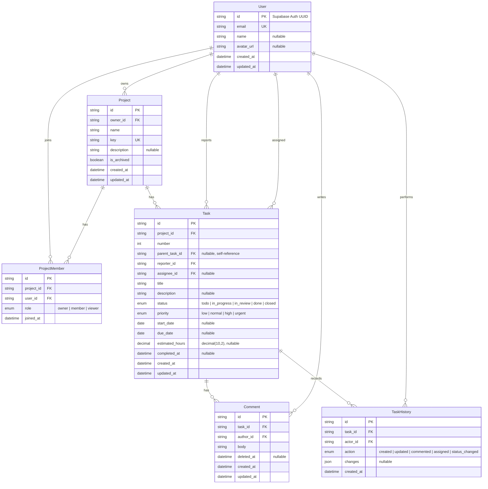

# Entity Relationship Diagram

この図は完成時のデータモデル案である。カラム定義とビジネスルールは、実装を進めながら本書と要件資料へ段階的に追記する。

## Task 一覧 API の初期実装

現在の作業ブランチでは、完成形の図から次の範囲だけを実装している。

- Task の項目は `id`・`projectId`・`title`・`description`・`status`・`priority`・`startDate`・`dueDate`・`createdAt`・`updatedAt` とする。
- DB のテーブル名は `tasks` とし、`project_id` は必須で `projects.id` を参照する。`ON DELETE RESTRICT` により、Task が残る Project の物理削除を拒否する。
- `description`・`start_date`・`due_date` は nullable、開始日・期限は `DATE` 型とする。status は `todo | in_progress | done`、priority は `low | normal | high` に限定し、初期値はそれぞれ `todo`・`normal` とする。
- 一覧取得用に `(project_id, created_at, id)` の複合 index を設ける。これは一意制約ではなく、Task の主キーは `id` である。
- [Task 追加の migration](../apps/api/prisma/migrations/20261026102234_add_task/migration.sql) は2つの enum・tasks テーブル・index・外部キーを追加する。既存テーブルの削除や既存データの更新は行わない。Prisma の `Project.tasks` は逆参照であり、projects テーブルにカラムを追加しない。
- 番号・親子関係・作成者・担当者・予定工数・完了日時は後続とする。上の図にあるそれらの項目・User との関連は、現在の Prisma schema には含めていない。

## 補足制約（完成形）

- `Task.parent_task_id` は `Task.id` を参照する自己参照FKである
- Mermaid上では可読性を優先し、TaskからTaskへの自己参照線を省略している
- `ProjectMember` は `(project_id, user_id)` の組み合わせで一意とする
- `ProjectMember.role` は初期実装では `owner | member | viewer` とする。`manager` は owner と member の間の権限が必要になった時点で追加を検討する
- `Task` は `(project_id, number)` の組み合わせで一意とする
