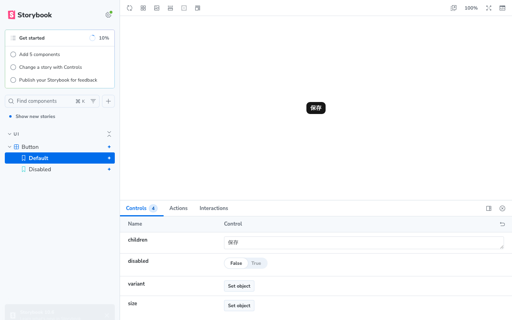

# Storybookで再利用UIの状態を確認する

コマンドは、指定がなければリポジトリのルートで実行します。現在の対象は、既存Buttonの通常・disabledの2状態です。

## Storybookの役割

Storybookは、UI部品に決まったpropsを渡し、画面から切り離して状態を表示するカタログです。

| 道具                           | 確認すること               | このプロジェクトでの例                      |
| ------------------------------ | -------------------------- | ------------------------------------------- |
| Storybook                      | 部品の見た目と状態         | Buttonの通常・disabled、狭い幅での表示      |
| Vitest + React Testing Library | UI操作とその結果           | フォーム送信時の入力エラー                  |
| Vitest + Supertest             | API・認証・認可・DB保存    | viewerによる更新の拒否                      |
| Playwright                     | 実ブラウザを通した主要導線 | ログインからProject作成、再読み込み後の表示 |

Storybookのbuildは、カタログを静的ファイルへ変換できることを確認します。画面の見た目・操作やAPI接続の正しさは、それぞれの確認が必要です。既存の `pnpm test:e2e` はAPI結合テスト、`pnpm test:browser` はPlaywrightのブラウザテストです。

## 導入した依存と設定

導入時のWebはNext.js 16.3.5・React 19.2.8・Tailwind CSS 4.3.3です。追加した直接依存は次の3つで、すべてWebの開発用依存です。

| パッケージ               | バージョン | 役割                                                |
| ------------------------ | ---------- | --------------------------------------------------- |
| `storybook`              | 10.6.3     | 起動・buildコマンド                                 |
| `@storybook/nextjs-vite` | 10.6.3     | Next.js向けのStorybook設定                          |
| `vite`                   | 8.3.0      | Storybookのビルド基盤。既存lockfileと同じバージョン |

Storybook側のビルドにViteを使います。既存のNext.jsの開発・buildコマンドはそのまま使います。追加addonはありません。[Next.js向けの公式ガイド](https://storybook.js.org/docs/get-started/frameworks/nextjs-vite)

`pnpm-workspace.yaml` の `allowBuilds` では、Storybookが利用する `esbuild@0.28.2` のpostinstallを許可しています。この処理はビルド用バイナリを準備・確認します。

| ファイル                                                               | 責務                                                                   |
| ---------------------------------------------------------------------- | ---------------------------------------------------------------------- |
| [main.ts](../apps/web/.storybook/main.ts)                              | frameworkと `src` 配下のstoryの検索先を指定する。telemetryも無効にする |
| [preview.ts](../apps/web/.storybook/preview.ts)                        | 全storyへ適用するCSSと、中央に配置する設定を読み込む                   |
| [preview.css](../apps/web/.storybook/preview.css)                      | Storybook用のシステムフォントを指定する                                |
| [button.stories.tsx](../apps/web/src/components/ui/button.stories.tsx) | 既存Buttonの通常・disabledを定義する                                   |

`preview.ts` はアプリと同じ `src/app/globals.css` を読み込みます。Tailwind CSS 4の処理には既存の `postcss.config.mjs` を使い、色・余白・枠などを共有します。

アプリのGeistはRootLayoutの `next/font/google` で設定されています。StorybookではRootLayoutを読み込まず、専用CSSでシステムフォントの変数を補います。Google Fontsへ接続せずに確認できますが、Geistとの完全一致を確認する構成ではありません。

## 起動・表示確認・終了

依存がまだ入っていない環境では、先にlockfileどおりにインストールします。

```bash
pnpm install --frozen-lockfile
```

次にStorybookを起動します。現在のButtonのstoryには、Web/APIの開発サーバー、Docker、Supabaseの起動や接続設定は不要です。

```bash
pnpm storybook
```

ルートのscriptがWebの `storybook` scriptを呼び、`storybook dev --host 127.0.0.1 -p 6006 --no-open` を実行します。`--host` は待ち受け先、`-p` はポート、`--no-open` はブラウザを自動で開かない指定です。

1. ブラウザで `http://127.0.0.1:6006` を開く。
2. 左側の `UI → Button → Default` を選び、通常の「保存」ボタンを確認する。
3. `Disabled` を選び、薄く表示され、操作できないことを確認する。
4. 通常ボタンにTabでフォーカスでき、disabledボタンがフォーカス対象にならないことを確認する。
5. ブラウザの開発者ツールで390px程度に幅を変え、部品に横スクロールや欠けがないことを確認する。

下部のControlsでpropsを変えると表示も変わります。上の確認は各storyの初期値で行います。別のターミナルで重複起動せず、起動中のターミナルで `Ctrl+C` を押して終了します。

### 表示例

手順1で取得した確認画像です。通常表示はStorybook全体、disabledは390px幅の部品表示です。




## Buttonのstoryを読む

現在のstoryは次の内容です。既存Buttonをファイルから直接importして使います。

```tsx
import type { Meta, StoryObj } from '@storybook/nextjs-vite';

import { Button } from '@/components/ui/button';

const meta = {
  title: 'UI/Button',
  component: Button,
  args: {
    children: '保存',
    disabled: false,
  },
} satisfies Meta<typeof Button>;

export default meta;
type Story = StoryObj<typeof meta>;

export const Default: Story = {};

export const Disabled: Story = {
  args: {
    disabled: true,
  },
};
```

- `title` は左側の一覧での分類名、`component` は表示する部品です。
- `args` は部品へ渡すpropsです。共通設定で文言と通常状態を定義します。
- `Default` は共通設定を使い、`Disabled` は `disabled` だけを上書きします。
- `Meta`・`StoryObj` と `satisfies` により、部品のpropsに合うstoryか型チェックできます。`satisfies` が実行時に入力を検証するわけではありません。

書き方の詳細は[TypeScriptによるstoryの公式ガイド](https://storybook.js.org/docs/writing-stories/typescript)を参照してください。

## ローカルbuildと変更後の確認

起動中のStorybookを終了してから、次を実行します。

```bash
pnpm storybook:build
```

Webの `storybook build` が動き、`apps/web/storybook-static` にHTML・CSS・JavaScriptを生成します。このコマンドは公開・デプロイを行いません。通常の `pnpm build` とStorybookのbuildは別のscriptです。[静的buildの公式ガイド](https://storybook.js.org/docs/sharing/publish-storybook)

生成物はGit・Prettier・ESLint・Webの型チェックから除外しています。`.storybook` のTypeScript設定とstory自体は、Webのlint・型チェックで確認します。`debug-storybook.log` もGitの対象外です。

設定やstoryを変更したら、表示確認と、影響する範囲のコマンドを順番に実行します。

```bash
pnpm format:check
pnpm --filter @redmine-next-nest/web lint
pnpm --filter @redmine-next-nest/web typecheck
pnpm storybook:build
```

UIの振る舞いを変更した場合は、関連するVitestも実行します。重いbuildやテストをむやみに同時実行しないでください。導入時のbuildでは500 kBを超えるチャンクの警告が出ましたが、buildは成功しています。

## CIでのbuild確認

[ci.yml](../.github/workflows/ci.yml) の `Quality checks` jobは、既存のアプリbuildの次に次のstepを実行します。

```yaml
- name: Build Storybook
  run: pnpm storybook:build
```

既存のNode.js 24・pnpm 11.9.0・`pnpm install --frozen-lockfile` の準備を利用します。現在のButtonのstoryをbuildするstepには、追加のDB・Supabase・GitHub Secretsは不要です。直前のアプリbuildにある公開用の仮設定は、そのstepだけの設定です。

develop向けPRとdevelopへのpushで実行され、Storybook buildが失敗すれば `Quality checks` も失敗します。ここではカタログの公開やartifactへの保存は行いません。

GitHub上の確認は、この変更をpush・PRへ反映した後に行います。Checksから `Quality checks → Build Storybook` を開き、コマンドが実行され、成功したことを確認します。ローカルbuildの成功と、GitHub上でのCI成功は分けて記録します。

## 現在の確認範囲と次の作業

2026-10-26に、エージェントが通常・disabledの表示、PC幅1280px・390px、フォーカス、外部HTTPリクエストがないこと、ローカルbuildを確認しました。ユーザーからも `pnpm storybook` の起動とButton表示の確認報告を受けています。CIのstepは追加済みです。ローカル確認時点ではGitHub上の実行結果は未確認で、PRのChecksで確認します。

最初のPRの範囲は、最小設定・Buttonの2状態・CI・本手順書です。その後、Input＋Labelの通常・disabled・固定の入力エラー表示、Badge、Alert、AlertDialogを1部品ずつ追加します。Task CRUDはStorybookの導入後に進めます。進捗と検証結果は[タスク7](./QUALITY_SECURITY_FOLLOW_UP_TASKS.md#7-storybook-で再利用-ui-の状態を確認できるようにする)に記録します。
